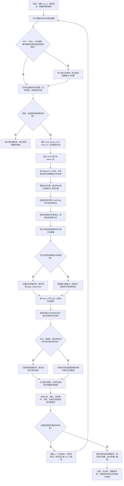
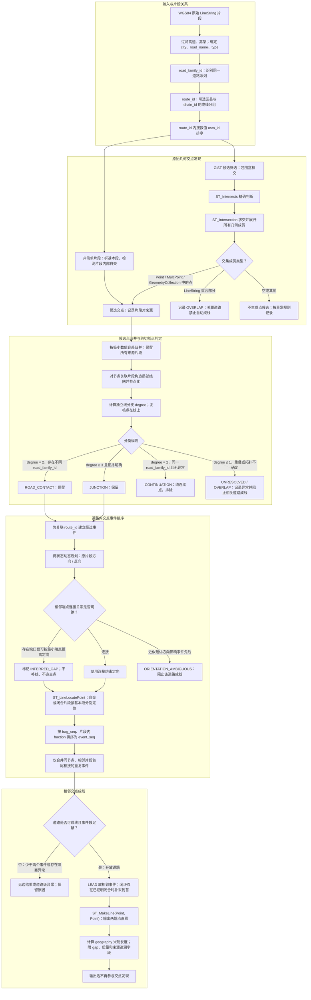

# 道路交点与交点间直线生成：流程图与空间计算逻辑图

本文基于《道路交点与交点间直线生成 P0 技术方案》，分别展示批处理闭环和空间计算核心逻辑。图中将“数据异常隔离”“道路级成线资格”“整批版本发布”作为不同层次处理：单条记录异常不应中断全城任务；道路存在影响拓扑或排序的阻塞异常时不发布该道路线段；全量结果完成对账后再切换正式版本。

## 1. 全流程闭环

### 闭环说明

- 输入级阻断（例如无法确认高架过滤依据）会停止该批次，修复配置后重新运行。
- 可隔离的数据问题进入异常表；不受影响的道路仍可继续处理。
- 纯连续点不作为交点事件。重叠、节点拓扑不确定或定向歧义会阻止受影响道路发布线段。
- 道路只有零个或一个有效交点属于正常无边结果，不等同任务失败。
- 发布前核验结果计数和几何约束；失败时保留上一版，成功后通过事务切换版本指针，避免暴露半成品。
- 新生成的直线不参与本批次求交；下一次运行也必须使用原始输入片段作为交点来源。

## 2. 空间计算逻辑图

### 空间逻辑要点

1. **交点来源**：交点只来自有效原始片段之间的精确交集，以及非简单 LineString 内部自交检测。包围盒只用于缩小候选范围。
2. **纯切割点**：以局部拓扑定义判断。degree 为 2、仅属于同一 road_family_id 且没有拓扑异常时，归为 CONTINUATION 并排除；不能因为点是片段端点就直接删除。
3. **道路归属与排序分开**：road_family_id 用于识别道路系列及判断纯连续点；route_id 用于具体排序、配对和成线，避免把多个独立道路链串起来。
4. **定向和排序**：osm_id 提供片段间顺序，动态规划选择每个片段的坐标方向；片段内按线性位置排序。节点与道路经过事件分开保存，以保留自交、闭环中的多次经过。
5. **缺失片段**：已有交点仍按事件顺序直接连接；缺口只作为质量信息记录，不从连接直线反推新交点。
6. **输出语义**：每条 LineString 只有两个端点，表达交点间直线连接，不代表原道路曲线或实际道路里程。长度用 WGS84 geography 计算为米。

## 3. 图中名称与方案术语对应

| 图中术语 | 含义 |
|---|---|
| road_family_id | 地市＋标准化道路名称＋标准化道路类型，用于识别道路系列 |
| route_id | road_family_id 加可选区县与 chain_id，用于排序和成线 |
| degree | 候选交点处局部线网的独立分支数 |
| CONTINUATION | 同一道路系列的二度连续点，按纯切割连接点排除 |
| JUNCTION / ROAD_CONTACT | 保留的路口或不同道路组接触点 |
| event | 某条 route_id 沿空间顺序经过某个 node 的一次记录 |
| edge | 两个相邻交点事件之间生成的两点直线 |
| INFERRED_GAP | 片段端点不连接时按方案规则推断的定向质量标记 |
