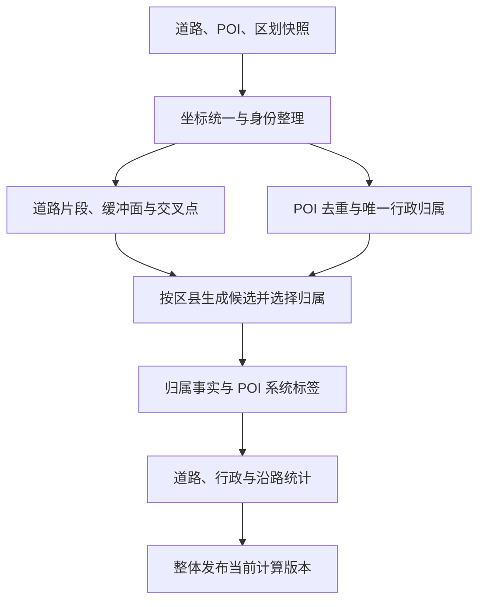

# 道路商家分布分析技术方案 P0

版本：V0.1  
日期：2026-10-16  
业务依据：业务架构 V0.3、业务方案 V0.2。业务方案核对至仓库提交 `7f9c39330774a0ccee0f7d83e62bb7af0fd89395`，并核对当前同名 Markdown 文件。  
技术定位：以 PostgreSQL + PostGIS 为计算与结果存储核心，以少量 Python/SQL 批任务完成道路预处理、POI 归属及系统打标。本文是可实施的设计，SQL 为核心实现模板，尚未连接目标数据库执行。

## 1 设计结论与第一性原理

这个问题的最小计算对象是：一个商家点、若干有身份的道路曲线，以及一套确定的候选和选择规则。最终需要的不是一张去掉重叠的道路面，而是**每个门店唯一的一条道路归属事实**。

因此，采用以下设计：

1. 道路 `path` 是唯一道路几何依据；等级决定单侧关联距离，缓冲面表达候选范围。
2. 行政归属先确定，所有道路候选均限定在商家所属区县。
3. 候选生成与最终选择分开；道路拓宽面允许重叠，不能先裁分重叠面替代业务决策。
4. 严格按交叉名称、交叉最近、普通单面、普通多面、无面兜底的顺序，生成一条最终归属。
5. POI 道路标签、等级标签、计算方式标签及沿路位置，均由这条归属事实派生；统计也使用这条事实。
6. 一次计算冻结道路、POI、行政边界、坐标处理和规则参数版本，发布时整体切换结果版本。

P0 直接利用已有 PostGIS 和大数据导入能力：大数据平台负责准备快照、去重和批量导入，PostGIS 负责精确空间计算。推荐先完成单个 PostgreSQL 实例上的区县并行批处理，再根据实测决定是否分布式化。

## 2 范围与业务规则映射

| 业务要求 | 技术实现 |
| --- | --- |
| 只使用道路 path | 解析成 LineString；道路 boundaries 不进入计算链 |
| 按道路等级拓宽 | 配置表确定 `buffer_m`，生成道路关联面；正式命中使用米制 `ST_DWithin` |
| 按区县拆分 | 来源道路按区县裁切；共享边界同一来源线段按区县编码唯一分配 |
| 交叉点名称优先 | 原始道路交点→交叉圆域→本区县交叉候选→POI 已有道路名精确匹配 |
| 名称未命中补候选 | 交叉候选 I 与点面候选 M 求并集，按距离选一条 |
| 普通点面关联 | 按道路单元去重，单单元直接归属，多单元候选中取最近 |
| 未命中面 | 本区县全部有效道路中最近距离兜底，无最大兜底距离 |
| POI 打标 | 结构化归属列 + 当前结果视图；保留原因和版本 |
| 四项指标 | 基于归属事实、道路长度和 100 米分析段计算 |

仅交叉圆域使用已有道路名称，不从 address 抽取、不做模糊匹配。二维交点不表达实际交通连通性。兜底直接进入正式统计，不增加兜底抽检、人工确认或准确率门槛。自定义业务标签仅预留，P0 打标指本次计算产生的系统标签。

## 3 最小技术架构



| 组件 | 职责 | P0 实现 |
| --- | --- | --- |
| 数据导入 | 快照、字段适配、门店去重、批量装载 | 复用现有大数据任务，CSV/数据库批量 COPY |
| 空间数据库 | 道路准备、相交、距离、候选选择、沿路定位 | 一个 PostgreSQL + PostGIS 实例 |
| 批任务入口 | 创建 run、按区县执行、失败重试、发布 | Python 命令行脚本调用 SQL；复用已有调度器即可 |
| 查询出口 | 当前 POI 标签、道路统计、道路明细 | SQL 视图；需要时提供少量 HTTP 查询接口 |

不要求另建标签平台、空间微服务、消息队列或实时流处理。前端不在本方案范围。

## 4 输入适配与坐标规范

### 4.1 已有字段的落地映射

| 当前附件字段 | 标准字段 | 处理 |
| --- | --- | --- |
| 道路 `id` | `source_record_id` | 来源记录身份，不能在没有依据时认定为跨记录整路身份 |
| 道路既有稳定整路 ID（如存在） | `source_road_id` | 统一同一道路；不存在时以来源记录 ID 作为 P0 道路身份 |
| `road_name` | `road_name_norm` | 仅去除首尾空白；同名不能作为合并身份的依据 |
| `path` | `geom_src` | 示例格式为 `经度_纬度;经度_纬度`，严格保留点顺序 |
| `type/sub_type` | 原始分类 | 当前样例有高铁、地铁，不能据此推定正式公路或城市道路等级 |
| 等级来源字段/客户映射 | `grade_system/grade_code` | 无法映射使用 UNKNOWN；不从 road_name 或 road_num 推断技术等级 |
| `zone_id/city_id` | 原行政属性 | 保留来源；正式所属区县按空间裁切确定，不依赖 zone_id 完整性 |
| POI 经营位置 `location` 或 `gcj_lon/gcj_lat` | `geom_raw` | 使用实际经营位置，保留原始数值与坐标类型 |
| POI `road` | `road_names_norm text[]` | 字段说明中为数组；标量统一转单元素数组，逐项去首尾空白、去空和去重 |
| `category_one/category_two` | `industry_l1/industry_l2` | 使用确定的一二级主行业，空值为 UNKNOWN |
| 现有稳定门店 ID | `poi_id` | 字段需在数据接入时明确；企业编码和统一社会信用代码不能默认当门店 ID |

道路名称数组中的任意一个名称与交叉候选道路名称全等即构成匹配。多个名称分别匹配多个单元时，仍在全部匹配片段中按统一距离规则选一条，不能只取数组第一项。

名称标准化在接入层用同一个函数执行，例如 Python `str.strip()`，再采用确定的逐字符全等比较。不删除内部空白，不替换“路/街/大道”，不增加别名。缺失、不可用的道路名统一为空数组，不影响空间计算。门店去重仅使用既有门店身份和确定的快照取值顺序，不做名称相似度实体识别。

### 4.2 坐标先于任何空间计算

POI 说明明确经营坐标含 GCJ-02。道路样例仅有坐标数值，没有足够信息证明其坐标基准；行政边界也需记录坐标基准。

实施顺序：

1. 为道路、POI、区划分别登记 `coord_system`、源 SRID、坐标处理方法版本。
2. 在现有 ETL 层取得或转换为一致的、已知地理基准坐标。GCJ-02 与 WGS84/CGCS2000 的差异不能通过修改 SRID 解决；需使用已确认的数据源或现有坐标处理能力。若不能取得统一基准，不能声称已完成可靠的米制关联。
3. 统一地理基准后，用 `ST_Transform` 投影到适合该省计算范围、单位为米的平面坐标系。P0 优先为全省固定一个适用的投影；省份和范围明确后再确定具体 SRID，不预先写死分带编号。
4. 所有距离、长度、缓冲、交点、裁切和线性定位使用同一 `geom_m`。原始点另存，不覆盖。

`ST_SetSRID` 只声明坐标参考，`ST_Transform` 才执行已定义参考系间的坐标变换；二者都不能自动识别或消除 GCJ-02 偏移。EPSG:3857 也不作为本方案精确计量的默认选择。

本方案的厘米比较精度是排序规则，不表示数据定位精度达到厘米级。投影选择需按目标省范围确认适用性，不能把这个排序精度当作投影误差要求。

### 4.3 几何与身份的最小约束

- path 至少包含两个不同且有限的有效坐标；去除连续重复顶点，不对道路做会改变相交关系的简化或吸附。
- 多条不连续 path 保持为多个 LineString；不能用直线跨空隙相连。
- 行政区划使用同一版本的有效面；允许共同边界，发现正面积重叠等区划底图问题时修正输入版本，不能把任意重叠也默认为业务共享边界。
- 门店重复记录按既有门店 ID 去重，更新时间相同则按固定来源行 ID 顺序取值；多表补充属性必须先整理为一店一行，避免连接扩行。
- 道路单元身份由 `(source_road_id, county_code)` 决定；计算片段身份在一次道路版本内冻结。用于排序的标识采用固定字节序或固定数值序，不能依赖执行顺序产生的临时序号。
- 来源没有可信的整路关联时，保持来源记录身份即可，不另建整路识别算法。若已有整路身份下出现不同规范名称，名称仍保留到来源片段，不能用一个任意名称覆盖全部片段。
- 无效 POI 保留输入记录和错误原因。区划外/无区县的 POI 保留 `ADMIN_UNRESOLVED`，不能强塞最近区县；无法确定区县的记录单列于输入异常清单，不伪造行政汇总。

## 5 数据模型

### 5.1 核心表

下面是逻辑表设计。`run_id` 是统一发布版本，基础数据有独立 `road_version/poi_version/admin_version`，均由 run 冻结。P0 可为每个 run 保存必要的计算快照，后续复用未变的道路底座时仍需保持外键版本一致。

| 表 | 主键/身份 | 核心内容 |
| --- | --- | --- |
| `calc_run` | run_id | 三类输入版本、规则配置、坐标配置、软件版本、状态、时间 |
| `calc_task` | run_id + county_code | 区县任务状态、重试次数、错误信息；协调全省发布 |
| `calc_active` | 固定单行 | 当前已发布 run_id |
| `admin_county` | run_id + county_code | province_code、city_code、有效区县面 geom_m |
| `road_source_part` | run_id + source_part_id | 行政裁切前连续线、原道路身份、来源记录、等级、buffer_m |
| `road_unit` | run_id + road_unit_id | source_road_id + county_code，汇总展示身份 |
| `road_chain` | run_id + chain_id | 同一路、同区县、同等级/宽度的连续分析线，供 100 米连续分段；普通情况下与计算片段一一对应 |
| `road_fragment` | run_id + fragment_id | 单元、来源、区县、road_name_norm、等级、buffer_m、连续 LineString、length_m、chain_id、chain_offset_m |
| `road_fragment_source` | run_id + fragment_id + source_part_id + 来源区间 | 连续计算片段与来源线的对应关系，供交叉参与映射 |
| `road_buffer` | run_id + fragment_id | `ST_Buffer` 后裁到唯一归属区县的面 |
| `road_junction` | run_id + junction_id | 原始线交点 q、radius_m；圆面可选保存 |
| `junction_source_part` | run_id + junction_id + source_part_id | 交叉点的原始参与线 |
| `junction_fragment` | run_id + junction_id + fragment_id | 对应本区县且进入圆域的有效参与片段 |
| `road_bin` | run_id + bin_id | 100 米分析段、所属连续分析线 chain_id、起止里程、实际长度、前后段关系 |
| `poi_snapshot` | run_id + poi_id | 去重后经营点、唯一行政归属、道路名数组、行业与输入状态 |
| `poi_road_assignment` | run_id + poi_id | 唯一归属、计算方式、距离、最近点、片段位置、系统打标 |

不把来源道路、区县道路单元、计算片段和 100 米分析段混用：单元用于道路统计，片段用于候选/等级/距离，分析段用于沿路分布。一个单元可以含多个等级、多个不连续片段。

`road_chain` 只解决连续统计定位，不增加分析层级；多数输入直接以片段作为 chain，偏移为 0。只有已有来源明确同一路连续、同等级但因名称记录等元数据保留多个计算片段时，才需要共享一个 chain，避免来源记录边界导致 100 米段重新起算。不推断未知道路的连续关系。

### 5.2 归属事实与 POI 打标字段

P0 用结构化列实现打标，避免把道路和等级仅塞进任意 JSON 或标签字符串。`poi_road_assignment` 是系统标签的权威来源，原始 POI 表不反复追加道路标签。

| 字段 | 类型建议 | 标签/事实含义 |
| --- | --- | --- |
| run_id / poi_id | bigint / text | 标签对应的版本和门店 |
| province_code / city_code / county_code | text | 经营点的行政标签 |
| source_road_id / road_unit_id / fragment_id | text | 归属道路、区县道路单元与具体片段；未关联为空 |
| grade_system / grade_code | text | 最终片段的道路等级标签 |
| industry_l1 / industry_l2 | text | 本次 POI 快照主行业；未知单列 |
| assignment_status | text | ASSIGNED 或 UNASSIGNED |
| assignment_method | text | 五类有效归属方式，见下表 |
| failure_reason | text | COORD_INVALID、ADMIN_UNRESOLVED 或 NO_ROAD_IN_COUNTY；有效归属为空 |
| in_junction_zone | boolean | 是否命中至少一个交叉圆域 |
| name_matched | boolean | 是否由交叉道路名优先规则选中 |
| matched_name | text | 选中道路的精确匹配名称；无匹配为空 |
| distance_m | double precision | 到最终 path 的原始计算距离 |
| distance_cmp_m | numeric | 按 0.01 米舍入的排序距离 |
| nearest_point_m | geometry(Point) | path 上最近位置；不是原始经营位置或入口 |
| fraction / measure_m | double precision | 最终片段上的比例位置与沿线里程 |
| chain_id / chain_measure_m | text / double precision | 连续分析线身份及其里程；普通情况下与片段一致 |
| bin_id | text | 所属沿路分析段 |
| buffer_m | double precision | 所选片段单侧距离，便于解释 |

| assignment_method | 对应中文 |
| --- | --- |
| JUNCTION_NAME | 交叉点名称归属 |
| JUNCTION_NEAREST | 交叉点最近归属 |
| BUFFER_SINGLE | 单面归属，按单元去重后只有一个单元 |
| BUFFER_NEAREST | 多面最近归属 |
| NEAREST_FALLBACK | 最小距离兜底 |

当前 POI 标签通过 `v_poi_road_tags_current` 输出，可连接冻结的 `poi_snapshot` 返回原始经营坐标和门店属性。归属方式与行政、道路、等级属于不同字段，不混成一个业务标签。

不生成“真实临街”“入口道路”“高置信度”等无法由现行规则证明的标签。不把距离远近映射成质量分数。

建议数据库直接约束：`(run_id, poi_id)` 主键；ASSIGNED 时道路、片段、等级、距离、bin_id 非空且 failure_reason 为空；UNASSIGNED 时归属道路与 bin_id 为空且 failure_reason 非空；片段长度和 buffer_m 大于零；fraction 在 0～1 内。事实以 `(run_id, fragment_id)` 引用计算片段，以 `(run_id, bin_id)` 引用分析段，禁止跨版本引用。行政、单元、片段、chain 和 bin 的对应关系在写入 SQL 中由同一关联链生成，并以发布前一致性查询核对。

## 6 道路底座预处理

### 6.1 道路等级与单侧距离

每段仅有一个最终计算等级和一个 `buffer_m`：适用城市道路等级优先，其次公路技术等级，否则 UNKNOWN。公路行政分类如国道、省道保留属性，不叠加拓宽距离。

| 体系 | 等级→单侧距离（米） |
| --- | --- |
| 城市道路 | 快速路 50；主干路 40；次干路 30；支路 20 |
| 公路技术等级 | 高速 50；一级 40；二级 30；三级 20；四级 10 |
| UNKNOWN | 20 |

沿用业务方案建议初值，不将其解释为国家标准道路宽度。`bin_length_m=100`。以上参数连同名称标准化、距离舍入方式一并冻结在 run 中；修改参数后重新计算，不覆盖旧版本事实。

### 6.2 原始交叉点先于行政裁切生成

对同坐标体系、等级一致的原始连续线：

1. 只在**不同 source_road_id** 之间生成道路对；同一路自身闭合、同一路连续记录接头不建立交叉点。
2. 用 GiST 包围盒过滤加 `ST_Intersects` 找出真正相交道路对，不能仅用 `ST_Crosses`，否则会漏掉 T 形或端点相接。
3. 每对仅计算一次 `ST_Intersection`，提取点状结果。线状重合结果不取连续采样点，也不把重合线端点自动转为圆域；GeometryCollection 中独立的点分量仍可保留。
4. 同一规范化几何位置按点坐标去重为一个 junction，合并全部参与线。使用同一次预处理的坐标精度和确定的排序产生 junction_id，不对邻近交点做任意距离聚类。
5. radius_m 取该点全部原始参与线的最大 buffer_m，包括交点处相接的不同等级片段；半径只计算一次，之后不因某区县候选较少而缩小。

交叉判断使用二维几何。道路实际未相接而坐标有缝隙时，P0 不自动补连接；仍走普通面关联规则。

核心操作示意：

```sql
-- s 为一个 run 的 road_source_part；geom_m 已统一为米制二维线。
CREATE TEMP TABLE tmp_pair_intersection AS
SELECT a.source_part_id AS a_id, b.source_part_id AS b_id,
       ST_Intersection(a.geom_m, b.geom_m) AS g
FROM s a JOIN s b
  ON a.source_part_id COLLATE "C" < b.source_part_id COLLATE "C"
 AND a.source_road_id <> b.source_road_id
 AND a.geom_m && b.geom_m
 AND ST_Intersects(a.geom_m, b.geom_m);

SELECT a_id, b_id, (ST_Dump(ST_CollectionExtract(g, 1))).geom AS q
FROM tmp_pair_intersection;
```

道路对计算不要使用 100 米统计段，否则记录切分会产生过多重复配对。数据确实过长时可以使用带来源映射的辅助搜索切片，只用于找原始道路对，精确求交仍回到原始来源线；不能让辅助切片改变道路身份或引入交叉点。

### 6.3 按区县唯一分配线段

不能对每个区县独立 `ST_Intersection` 后直接累加，因为共享边界道路会重复。P0 采用**按来源线逐条、区县编码升序逐次裁取并扣除**的确定性算法：

```text
remaining = 当前来源连续线
counties = 与该来源线相交的区县，按 county_code 固定升序
for county in counties:
    owned = 只提取线(ST_Intersection(remaining, county.geom))
    输出 owned 中长度 > 0 的线，唯一归该 county
    remaining = 只提取线(ST_Difference(remaining, county.geom))
```

正常跨区线段会分到各自区县；共享边界上的同一来源线先被编码最小区县取得，后续区县无法再次取得。点状接触不输出为道路片段。`remaining` 若有省范围外的线，记录为范围外剩余，不计入省内长度。

该算法按原始来源分别执行，不能先把全省道路溶解成一条线。同一来源线的裁切片段不重复；**不同来源道路即使几何重合，仍按业务身份分别保留**。同一道路内部重复来源记录应在身份整理阶段处理，不能利用全省空间溶解来替代数据去重。

裁切后，在同一道路身份、同一区县、同一等级/宽度且端点连续的条件下，合并可连续的线形成计算片段，并保留来源对应关系。`ST_LineMerge` 可能返回 MultiLineString，必须再逐条拆出连续 LineString；分叉、断开处分别起算。不通过道路交点强制把一条连续道路切成 100 米计算片段。

合并还需保留道路名称的可判定性：仅合并规范名称一致的计算片段，不把不同名称强行替换成一个名称。对已有来源明确同一路、同县、同等级/宽度的连续关系，可先生成 road_chain，再保留其名称计算片段；每个计算片段按 chain 方向存线，并记录 chain_offset_m。100 米分析段沿 chain 起算，名称记录边界不制造额外空隙。P0 按来源记录识别道路时，无需推断这些跨记录连续关系。

### 6.4 生成面与建立交叉参与映射

关联面的几何表达：

```sql
ST_Intersection(
  ST_Buffer(fragment.geom_m, fragment.buffer_m,
            'endcap=round join=round quad_segs=16'),
  county.geom_m
)
```

提取有效面分量保存为 `road_buffer`；不在不同道路之间做 Union 或重叠消除。

交叉参与映射必须通过 `junction_source_part` 与 `road_fragment_source` 的来源关系建立：对某 junction 的原始参与线，寻找其唯一归属某区县、且与该交叉圆域相交的后代片段，写入 `junction_fragment`。用 `ST_DWithin(fragment.geom_m, q, radius_m)` 判断其是否进入圆域。

这样处理：圆心位于邻县但圆域伸入本县时，本县有效参与片段仍可成为候选；沿边界已分给其他区县的片段不会复制回来。不能仅凭相同 road_name 或相同整路 ID 将远处所有片段加入某交叉点。

一个原始参与连续线在圆域内若有多个有效后代片段，全部保留；POI 命中圆域后对这些片段计算距离，不再要求 POI 位于这些片段各自的拓宽面内。

## 7 POI 归属计算

### 7.1 行政归属

对有效经营点使用 `ST_Covers(county.geom_m, poi.geom_m)`，覆盖面内部及边界。多县命中按区县编码固定升序选择一个；已确认区划不存在正面积重叠时，这主要解决边界点。市、省编码从该区县的标准层级表取得，不从 POI 自由文本推断。

坐标无效先保留 COORD_INVALID；有效点未命中任何区县保留 ADMIN_UNRESOLVED；已归属区县但无有效道路保留 NO_ROAD_IN_COUNTY。以上异常不进入正常空间候选计算。

### 7.2 拓宽面命中使用精确距离定义

业务面定义是：本区县内距片段 path 不超过 buffer_m 的位置。对于已经属于本区县的 POI，正式候选条件直接写为：

```sql
r.county_code = p.county_code
AND ST_DWithin(r.geom_m, p.geom_m, r.buffer_m)
```

面图层仍按第 6.4 节生成并可输出；但判定不以这个离散多边形为唯一依据。原因是 `ST_Buffer` 的圆弧由线段近似，圆端点附近“距离正好命中”的点可能落在近似多边形外。增加 quad_segs 只能减少偏差，不能使多边形等于理想圆域。

因此，不先用 `ST_Covers(buffer_geom, point)` 丢弃记录再做距离判断，也不把缓冲多边形包围盒作为必经且可能漏点的过滤器。采用原始线的 `ST_DWithin`，与业务“距离 ≤ b，含边界”保持一致。

查询优化时先以当前区县实际 `b_max` 做常量距离过滤，再按逐片段 buffer_m 精筛：

```sql
ST_DWithin(r.geom_m, p.geom_m, :county_b_max)
AND ST_DWithin(r.geom_m, p.geom_m, r.buffer_m)
```

第一项仅缩小搜索范围；第二项是正式语义，不允许省略。`:county_b_max` 必须从该 run 的实际片段参数求得，不能把当前 50 米建议值硬编码为永久最大值。

### 7.3 交叉圆域与三个候选集合

对 POI 点 p：

- `Q(p)`：`ST_DWithin(p, q, radius_m)` 命中的全部交叉点，包含圆周。
- `I(p)`：Q 的参与后代片段中唯一归属 p 所属区县的片段，并去重。
- `M(p)`：按第 7.2 节命中的本区县拓宽片段，并去重。
- `N(p)`：I 中 road_name_norm 与 p.road_names_norm 任一非空值全等的片段。

圆域同样使用 `ST_DWithin`，不通过近似圆多边形决定边界。圆心即使位于县外，只要圆域影响本县，仍应被本县查询加载；不能先按圆心所属区县裁掉。

全部命中的交叉圆域一次合并。道路名只匹配 I，不匹配补入的普通面道路 M；这是既定业务优先级，不能因为 M 中某路名称相同就升级成名称优先。

### 7.4 最终选择

| 条件 | 最终候选 | 方法 |
| --- | --- | --- |
| Q 非空且 N 非空 | N | JUNCTION_NAME |
| Q 非空、N 为空且 I∪M 非空 | I∪M | JUNCTION_NEAREST |
| 上两项不成立，M 去重后只有一个道路单元 | M | BUFFER_SINGLE |
| 上两项不成立，M 去重后有多个道路单元 | M | BUFFER_NEAREST |
| M 为空且前述均不成立 | 本区县全部有效片段 | NEAREST_FALLBACK |

所有需要选片段的分支，包括单道路单元内多片段，统一使用：

```sql
ORDER BY round(distance_m::numeric, 2),
         road_unit_id COLLATE "C",
         fragment_id COLLATE "C"
LIMIT 1
```

**按 0.01 米精度先舍入再排序**，不使用“两个距离差小于 0.01 就视为同距”的非传递比较。保留 distance_m 原值，排序值另存。道路等级、候选来源数量和原始距离均不能插入标识排序之前破坏已约定同距规则。

名称匹配到一个道路单元时仍在其匹配片段中选出一条，供等级和沿路位置使用；多个单元也使用同一排序，无需另建名称评分。

### 7.5 无最大距离的最近兜底

兜底必须在本区县全部有效片段中求最近，不能只查当前网格或固定半径内道路。

为兼顾索引与厘米排序：

1. 在区县道路表用 `ORDER BY geom_m <-> p.geom_m LIMIT 1` 取得原始最小距离 d_min。
2. 再取 `ST_DWithin(geom_m, p.geom_m, d_min + 0.01 + 1e-9)` 的全部候选。
3. 对这批候选按第 7.4 节舍入距离及固定 ID 排序，选择一条。

第 2 步的 0.01 米是取齐同一舍入桶的技术余量，1e-9 是搜索边界的浮点保护；都不是兜底距离上限，也不改变拓宽面命中范围。因为与最小距离舍入后相同的距离只可能落在其后不足 0.01 米内，该方法不会漏掉应参与固定 ID 决胜的片段。

例如道路 B 距离 10.001 米，道路 A 距离 10.004 米，两者舍入均为 10.00；若 A 的单元 ID 在前，应选 A。直接把 KNN 第一条 B 当最终答案会违反业务同距规则。固定取前 K 条后重排也无法保证所有同距候选都被包含。

## 8 POI 沿路定位与分析段标签

### 8.1 连续线上的定位

最终片段必须是有效连续 LineString。计算：

```sql
fraction = ST_LineLocatePoint(fragment.geom_m, poi.geom_m)
measure_m = fraction * fragment.length_m
nearest_point_m = ST_LineInterpolatePoint(fragment.geom_m, fraction)
chain_measure_m = fragment.chain_offset_m + measure_m
```

`fraction` 为 0～1 的片段沿线比例；chain_measure_m 用于连续分析线上的分段。默认 chain 即片段、chain_offset_m=0。不得重新对整条 chain 求最近来覆盖已经按名称或空间规则选中的片段位置。经营位置仍用原始 POI 点；nearest_point_m 只是统计投影点。

### 8.2 100 米分段与唯一段归属

在区县、等级或不连续位置分别起算。每段起止里程为 `[k×100, min((k+1)×100, L)]`，L 为连续分析线 chain 长度。通过 `ST_LineSubstring` 在 chain 上生成段几何，并以 `end_m-start_m` 保存实际长度。

对于非闭合线：

```text
bin_count = ceil(L / 100)
bin_index = min(floor(chain_measure_m / 100), bin_count - 1)
```

段边界按左闭右开处理，最终端点归最后一段；不通过“点是否命中多个段几何”重复计数。bin_id 由 chain_id 和 bin_index 确定。

开路线的方向优先保留来源顺序；合并或裁切后按来源映射或确定的端点排序固定方向，避免每次重跑里程方向翻转。闭合环路固定起点和方向：优先沿用稳定源线起点；需要重建时以确定的最小顶点和固定邻接顺序建立，不跨版本随意改变。

闭合 chain 的里程 L 与 0 是同一位置，统一映射到 0（默认 chain=片段时对应 fraction=1 与 0）；首段与末段设置循环 prev_bin_id/next_bin_id。段长度仍按实际长度计算，末段可以不足 100 米，不因它短就被解释为空白段。不连续或跨区拆开的线不建立虚假的首尾连接。P0 只输出各段数量、密度和邻接关系，不开展集聚识别模型。

同一连续 path 若存在精确等距的多个沿线位置，P0 采用冻结几何及软件版本下 PostGIS 的确定返回位置；不推断商家入口。升级几何处理库或重建线方向需新建计算版本，避免静默改变 bin 标签。

## 9 计算核心 SQL 模板

本节给出可直接改造成任务 SQL 的核心。输入适配、坐标统一、道路预处理与入库由前文定义；本节不将其伪装成已经完成的生产脚本。

### 9.1 单区县计算上下文

每个区县任务创建独立数据库会话，加载同一 run 的本区县数据：

```sql
-- 由任务绑定 :run_id、:county_code；占位符不是 SQL 字面量。
CREATE TEMP TABLE t_road AS
SELECT fragment_id, road_unit_id, source_road_id, road_name_norm,
       grade_system, grade_code, buffer_m, length_m, geom_m,
       chain_id, chain_offset_m
FROM road_fragment
WHERE run_id = :run_id AND county_code = :county_code;
CREATE UNIQUE INDEX ON t_road(fragment_id);
CREATE INDEX ON t_road USING gist(geom_m);
ANALYZE t_road;

CREATE TEMP TABLE t_poi AS
SELECT poi_id, geom_m, road_names_norm
FROM poi_snapshot
WHERE run_id = :run_id AND county_code = :county_code
  AND input_status = 'VALID';
CREATE UNIQUE INDEX ON t_poi(poi_id);
CREATE INDEX ON t_poi USING gist(geom_m);
ANALYZE t_poi;

-- t_junction 加载全部圆域影响本县的交点，而非仅县内圆心。
CREATE TEMP TABLE t_junction AS
SELECT j.junction_id, j.q, j.radius_m
FROM road_junction j JOIN admin_county a ON a.run_id=j.run_id
WHERE j.run_id=:run_id AND a.county_code=:county_code
  AND ST_DWithin(j.q, a.geom_m, j.radius_m);
CREATE UNIQUE INDEX ON t_junction(junction_id);
CREATE INDEX ON t_junction USING gist(q);
ANALYZE t_junction;

CREATE TEMP TABLE t_jf AS
SELECT jf.junction_id, jf.fragment_id
FROM junction_fragment jf JOIN t_junction j USING (junction_id)
JOIN t_road r USING (fragment_id)
WHERE jf.run_id=:run_id;
CREATE UNIQUE INDEX ON t_jf(junction_id, fragment_id);
```

若本区县有效道路为空，将本县有效 POI 写入 NO_ROAD_IN_COUNTY，跳过后续 SQL。较大区县可按 poi_id 范围分批加载 t_poi，但 t_road、t_junction、t_jf 始终保持本县完整候选范围。

### 9.2 生成候选

```sql
-- :b_max 来自 t_road 的实际最大 buffer_m。
CREATE TEMP TABLE t_m AS
SELECT p.poi_id, r.fragment_id
FROM t_poi p JOIN t_road r
 ON ST_DWithin(r.geom_m, p.geom_m, :b_max)
AND ST_DWithin(r.geom_m, p.geom_m, r.buffer_m);
CREATE UNIQUE INDEX ON t_m(poi_id, fragment_id);

-- :r_max 为本次所加载交点的实际最大 radius_m。
CREATE TEMP TABLE t_q AS
SELECT p.poi_id, j.junction_id
FROM t_poi p JOIN t_junction j
 ON ST_DWithin(j.q, p.geom_m, :r_max)
AND ST_DWithin(j.q, p.geom_m, j.radius_m);
CREATE UNIQUE INDEX ON t_q(poi_id, junction_id);

CREATE TEMP TABLE t_i AS
SELECT DISTINCT q.poi_id, jf.fragment_id
FROM t_q q JOIN t_jf jf USING (junction_id);
CREATE UNIQUE INDEX ON t_i(poi_id, fragment_id);

-- 同一片段同时来自 I/M 时只保留一条，保存两种来源标记。
CREATE TEMP TABLE t_c AS
SELECT poi_id, fragment_id, bool_or(from_i) AS from_i,
       bool_or(from_m) AS from_m
FROM (
 SELECT poi_id, fragment_id, true AS from_i, false AS from_m FROM t_i
 UNION ALL
 SELECT poi_id, fragment_id, false AS from_i, true AS from_m FROM t_m
) x GROUP BY poi_id, fragment_id;

CREATE TEMP TABLE t_score AS
SELECT c.*, r.road_unit_id,
       (c.from_i AND r.road_name_norm <> '' AND
        EXISTS (SELECT 1 FROM unnest(p.road_names_norm) AS n(name)
                WHERE n.name COLLATE "C" = r.road_name_norm COLLATE "C"))
         AS name_ok,
       ST_Distance(r.geom_m, p.geom_m) AS distance_m
FROM t_c c JOIN t_road r USING (fragment_id)
JOIN t_poi p USING (poi_id);
CREATE UNIQUE INDEX ON t_score(poi_id, fragment_id);
ANALYZE t_score;
```

`road_names_norm` 和 `road_name_norm` 预先非空规范化（空名称使用空数组/空字符串），避免 NULL 传播。空交点集合可直接生成空 t_q/t_i，不影响普通归属。

### 9.3 决策并选择一条

```sql
CREATE TEMP TABLE t_flags AS
SELECT p.poi_id,
       EXISTS (SELECT 1 FROM t_q q WHERE q.poi_id=p.poi_id) AS has_q,
       EXISTS (SELECT 1 FROM t_score s
               WHERE s.poi_id=p.poi_id AND s.name_ok) AS has_name,
       (SELECT count(DISTINCT s.road_unit_id) FROM t_score s
         WHERE s.poi_id=p.poi_id AND s.from_m) AS m_units
FROM t_poi p;

CREATE TEMP TABLE t_winner AS
SELECT DISTINCT ON (s.poi_id) s.poi_id, s.fragment_id,
       s.distance_m, round(s.distance_m::numeric,2) AS distance_cmp_m,
       CASE WHEN f.has_q AND f.has_name THEN 'JUNCTION_NAME'
            WHEN f.has_q THEN 'JUNCTION_NEAREST'
            WHEN f.m_units=1 THEN 'BUFFER_SINGLE'
            ELSE 'BUFFER_NEAREST' END AS assignment_method
FROM t_score s JOIN t_flags f USING (poi_id)
WHERE CASE WHEN f.has_q AND f.has_name THEN s.name_ok
           WHEN f.has_q THEN true
           ELSE s.from_m END
ORDER BY s.poi_id, round(s.distance_m::numeric,2),
         s.road_unit_id COLLATE "C", s.fragment_id COLLATE "C";
CREATE UNIQUE INDEX ON t_winner(poi_id);
```

有圆域但 I∪M 为空的 POI 不出现在 t_score，继续走兜底；多个圆域的候选已经去重，不会产生多条最终事实。

### 9.4 未归属 POI 的完整县域最近兜底

```sql
INSERT INTO t_winner
  (poi_id, fragment_id, distance_m, distance_cmp_m, assignment_method)
SELECT p.poi_id, w.fragment_id, w.d, round(w.d::numeric,2),
       'NEAREST_FALLBACK'
FROM t_poi p
LEFT JOIN t_winner old USING (poi_id)
CROSS JOIN LATERAL (
  SELECT ST_Distance(r.geom_m,p.geom_m) AS d_min
  FROM t_road r
  ORDER BY r.geom_m <-> p.geom_m
  LIMIT 1
) nearest
CROSS JOIN LATERAL (
  SELECT r.fragment_id, ST_Distance(r.geom_m,p.geom_m) AS d
  FROM t_road r
  WHERE ST_DWithin(r.geom_m,p.geom_m,nearest.d_min+0.01+1e-9)
  ORDER BY round(ST_Distance(r.geom_m,p.geom_m)::numeric,2),
           r.road_unit_id COLLATE "C", r.fragment_id COLLATE "C"
  LIMIT 1
) w
WHERE old.poi_id IS NULL;
```

输入 t_road 已是本区县完整道路，因此 KNN 不会在省级候选中误选邻县。需用目标库的 `EXPLAIN (ANALYZE, BUFFERS)` 确认 LATERAL KNN 内层使用 GiST 距离排序扫描；不能只因创建了索引就假定查询一定使用。

### 9.5 写入最终事实

将 t_winner 连接 t_road、road_chain 与该 run 的 poi_snapshot，填充道路、区县、等级、行业与规则标签；按第 8 节填 fraction、measure_m、chain_measure_m、nearest_point_m 和 bin_id。JUNCTION_NAME 的 matched_name 取所选道路的规范化名称。

所有该输入快照中的未关联 POI 也写入一条结果，状态 UNASSIGNED，并保留唯一 failure_reason。事实主键 `(run_id, poi_id)`；每店一条，不采用“一个道路标签一行”来直接做商家计数。

为避免逐 POI 小事务，按区县或 POI 批次 `INSERT ... SELECT`。同一区县重试时，在一个事务中清理该 run 本县既有结果并重写，或按批次主键覆盖；发布后的 run 不允许原地修改。

## 10 统计模型与最简查询服务

### 10.1 数量与长度分开计算

两条独立事实：

- 商家事实：从 `poi_road_assignment` 取 ASSIGNED，每店一行，包含兜底。
- 长度事实：从 `road_fragment` 取所有有效片段，包含零商家道路，按相同道路等级范围求和。

不能把商家事实直接 JOIN 道路片段后 SUM(length_m)，否则一道路片段有多少商家就会被累计多少次。也不能只统计有商家的道路长度。

```text
道路密度 = 符合行业及道路等级条件的已归属商家数
           /（符合道路等级条件的全部道路长度米 / 1000）
```

行业条件仅作用于商家，不能缩短道路分母；道路等级条件同时作用于最终归属片段和对应长度。省、市密度以汇总商家数÷汇总长度计算，不平均下级密度。长度为零时返回 NULL/不适用。

### 10.2 P0 输出

| 视图/结果 | 粒度 | 用途 |
| --- | --- | --- |
| `v_poi_road_tags_current` | 一店一行 | 道路标签、等级、方式、距离、实际位置、行业 |
| `v_road_length_current` | 区县道路单元 + 等级 | 道路长度分母 |
| `v_road_merchant_current` | 区县道路单元 + 等级 + 行业 | 数量、行业结构；按需汇总 |
| `v_road_bin_current` | 100 米分析段 | 全部段长度及零商家段，连接商家计数 |
| `v_area_merchant_current` | 省/市/区县 | 区域输入量、已关联量、异常未关联量 |

行业占比的分母是同一行政/道路/等级及当前商家过滤范围下的归属商家数，未知行业也参与分组，使用一个确定的主行业，不把二级行业的重复映射扩成多店。

区域总量单独来自 poi_snapshot，不受道路等级筛选影响；按等级展示的是相应道路归属子集。行政归属不明的输入单独列示，不能将其强行分配到某区县对账。全省输入还应能对账到“省内有行政归属输入 + 行政无法确定/范围外输入”。

如需提供后端，只保留四类读接口：行政汇总、道路汇总、道路商家明细、沿路段统计。共同接受 run_id（默认当前）、行政条件、等级与行业；道路明细按 poi_id 稳定分页。下载大批标签用 SQL/COPY 或已有大数据导出任务，不增加独立服务。

## 11 批处理、版本和更新

### 11.1 P0 首次全量

1. 接收客户过滤后的道路、去重后的门店快照和区划边界，登记数据版本。
2. 冻结坐标处理、投影、等级拓宽、100 米分段、舍入规则和软件版本，创建 run_id。
3. 完成原始道路交点、行政拆分、缓冲面和交叉参与映射，建立索引并 ANALYZE。
4. POI 确定行政归属；按区县调度候选、选择、定位、系统打标。
5. 按区县生成统计，完成必要的唯一性和计量一致性检查。
6. 所有预期区县任务成功、输入异常记录已写入且统计完整后，一个短事务将 calc_active 切到新 run_id。缺少道路的区县也需要成功完成异常结果，不能当作任务遗漏。

查询始终通过同一个 active_run 读取事实、POI 快照、长度和分析段，不能分别读取“最新 POI”与“旧道路统计”。旧版可继续查询或回切 active_run；不通过手改标签回滚。

### 11.2 更新策略

P0 默认采用版本化批重算，先保证结果确定：

| 变化 | 重算范围 |
| --- | --- |
| 首次计算、道路/区划/投影/规则变化 | 新建完整 run，重新准备受影响底座并完成全省发布 |
| POI 坐标或已有道路名变化 | 新 run 中重算对应门店；P0 也可直接重算所在区县，降低增量实现复杂度 |
| 仅行业等非空间属性变化 | 复用道路归属及沿路位置，刷新该版本属性标签和统计 |
| POI 删除/失效 | 新快照中按客户已确定的输入范围处理，不继续保留旧版当前标签 |

只要道路候选发生变化，就不能仅重算“靠近变化道路”的 POI：无距离上限的兜底商家可能位于很远处；交叉参与变化还可能影响邻近区县的圆域。P0 使用完整批重算规避遗漏，无需设计复杂空间增量影响追踪。

若复用未变化县的数据，必须连同道路底座、归属、POI 快照和统计复制/引用同一组冻结版本，不能仅复用单张标签表。本方案优先选择完整 run，暂不引入县级多版本拼接发布机制。

## 12 性能与大数据协作

### 12.1 索引和执行边界

- 持久表按 run_id、county_code、poi_id 或 fragment_id 建普通索引；几何列建立 GiST。
- junction_fragment 建 `(run_id, junction_id, fragment_id)`，并建立查询县内片段所需的反向索引。
- 区县会话中的 t_road 创建本县 GiST，明确 KNN 搜索域；避免省级 KNN 先找邻县再过滤造成大量无效扫描。
- 批量导入用 COPY；底座及大批结果写完后 ANALYZE，避免逐店请求数据库。
- 候选临时表仅保留 POI ID、片段 ID 和必要标志，避免重复携带长几何和大 JSON。候选可在该县成功后清理，归属事实保留必要证据即可。
- 有效圆域为空时跳过交叉连接；道路为空时直接落异常结果，避免无意义扫描。

### 12.2 并行方式

建议首先以区县作为并行和重试单元，初始 2～4 个工作进程仅作为调度初值，根据磁盘、内存、查询计划与锁等待调整，不承诺固定耗时或吞吐。

大县内部可将 POI 按 ID 范围分批，所有批次共用完整的县道路和交叉候选底座。不能只给某网格 POI 提供网格内道路；普通面关联需要搜索扩展，兜底更需要全县范围。P0 不做依赖固定网格邻域的近似最近计算。

数据量尚无完整规模、线顶点数和候选密度统计，不能直接断言必须上 Spark/Flink。已有大数据平台适合承担导入和输出；精确空间计算优先由现有 PostGIS 实践完成。后续若瓶颈明确，再将相互独立区县分配到更多计算实例，同时保留本方案的同一坐标、候选完整性和唯一归属语义。

## 13 实施顺序与必要验证

| 阶段 | 交付结果 | 完成条件 |
| --- | --- | --- |
| 1 数据适配 | 标准 POI、标准来源线、区划和参数快照 | 坐标处理路径明确，门店/道路身份明确；字段缺失有确定处理 |
| 2 道路底座 | 唯一归属片段、缓冲面、交叉关系、100 米段 | 共享边界长度不重复，交叉身份及来源映射可用 |
| 3 关联与打标 | 一店一行最终事实 | 五类分支和输入异常都有结果，固定排序可重复 |
| 4 汇总与发布 | 当前标签视图、道路与行政统计 | 数量、长度、分析段一致后整体发布 |

测试是空间计算实现的正确性检查，**不是对兜底结果增加业务合理性抽检或审批**。必要的最小案例包括：

| 案例 | 必须验证的结果 |
| --- | --- |
| 单面、多面、同一单元多片段 | 按道路单元分类，不重复归属 |
| 业务示例 (25,35)/(25,30) | 前者普通单面归 A，后者交叉最近归 B |
| 交叉名称优先、名称数组多个匹配 | 名称只匹配 I；在完整匹配集合中选片段 |
| A/B 交叉附近 C 面命中 | 无名称匹配时 I∪M 中允许 C 胜出 |
| 多圆域重叠 | 一次合并候选，仅一条归属 |
| path 缓冲圆弧边界、交叉圆周 | 距离边界包含，不被面近似误排除 |
| 原始距离不同但舍入相等 | 固定 ID 决胜；KNN 两阶段与全县精确排序结果一致 |
| 共享行政边界、普通跨区线 | 同一来源共享段只归一个县，普通穿越按实际拆分 |
| 圆心在邻县、圆域进入本县 | 交点不会被县内圆心过滤错误丢弃 |
| 闭环起终点、100 米边界、最终端点 | 每店只进入一个 bin，首尾邻接正确 |
| 无道路/无效坐标/区划外 | 结果保留且异常原因明确 |

计算不变量：

- `(run_id, poi_id)` 唯一；该输入快照每店对应一条归属结果或明确异常结果。
- 有效归属的 POI 区县与最终道路片段区县相同；来源、道路单元、等级均一致。
- 无道路等级过滤时，已确定区县的输入量 = 有效归属量 + 本县可归类的异常未关联量；全省另列无法确定行政归属输入。
- 各道路已归属门店数之和 = 区县已归属门店数；每道路 bin 商家数之和 = 同范围道路商家数。
- 每个 chain 的 bin 长度之和 = chain 长度 = 对应不重复片段长度之和；同来源共享边界长度仅出现一次；省内唯一分配长度与来源线在分析行政范围内的长度一致，允许仅几何运算浮点误差。
- 同一个 run 重跑后道路、片段、方式、比较距离及 bin 标签保持一致。

实现完成后在目标 PostgreSQL/PostGIS 上执行这些案例与查询计划检查。本次文档交付不声称已完成真实库运行、性能压测或实际数据归属效果验证。

## 14 实施前只需落实的输入项

以下是把方案变为实际任务所需的最小接入信息，不新增业务功能：

1. 实际省份及道路、POI、区划的坐标基准和现有转换能力，据此固定米制计算 SRID。
2. 稳定门店 ID、道路身份字段、道路等级字段及字典；POI road 的实际存储格式。
3. 业务方案建议的拓宽参数与 100 米分析段长度采用哪一版；目前文档沿用建议初值。
4. 道路数量、顶点数、POI 数量与目标更新周期，用于确定批大小、并行度和运行窗口。

这些输入未给出时，技术方案和计算逻辑可以先定稿；正式运行配置不能凭样例坐标、示例铁路类型或企业 ID 猜测。

## 15 技术依据

业务文件：

- [业务方案 P0 V0.2](https://github.com/dfsvavw/test_demo/blob/7f9c39330774a0ccee0f7d83e62bb7af0fd89395/产品方案/道路商家分布分析P0/道路商家分布分析业务方案_P0.md)

以下官方文档用于核对函数语义；具体部署版本沿用现有可用 PostgreSQL/PostGIS，并记录 `version()` 与 `PostGIS_Full_Version()`，不要求为本方案强制升级。

- [ST_Transform：转换坐标，区别于设置 SRID](https://postgis.net/docs/ST_Transform.html)
- [ST_DWithin：同一坐标系中的距离阈值及索引预筛](https://postgis.net/docs/ST_DWithin.html)
- [ST_Buffer：圆弧近似、圆端点与距离范围](https://postgis.net/docs/ST_Buffer.html)
- [ST_Covers：包含边界的覆盖](https://postgis.net/docs/ST_Covers.html)
- [ST_Intersection：相交几何结果](https://postgis.net/docs/ST_Intersection.html)
- [ST_LineMerge：连续合并的条件与多线返回](https://postgis.net/docs/ST_LineMerge.html)
- [geometry <->：二维 KNN 距离排序](https://postgis.net/docs/geometry_distance_knn.html)
- [ST_LineLocatePoint：最近位置的沿线比例](https://postgis.net/docs/ST_LineLocatePoint.html)
- [PostgreSQL numeric：数值舍入语义](https://www.postgresql.org/docs/current/datatype-numeric.html)
- [高德坐标体系说明](https://developer.amap.com/api/javascript-api-v2/guide/transform/convertfrom)

上述资料只支持函数和坐标语义；候选优先级、厘米同距、区县唯一归属和参数初值均来自已确认业务规则或本文明确的实现选择。
